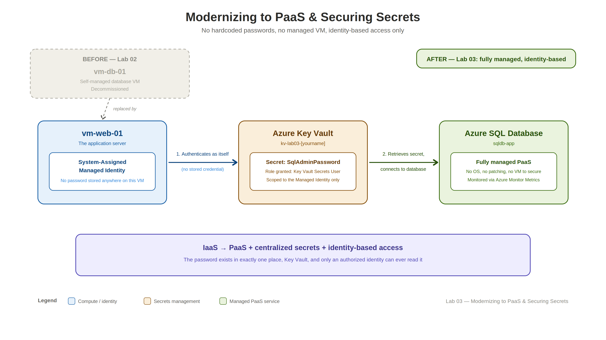

# Lab 03 — Modernizing to PaaS & Securing Secrets

Modernizing the Lab 02 architecture by replacing the self-managed database VM with Azure SQL Database and securing database credentials with Azure Key Vault and Managed Identity.


## 🎥 Watch Me Live

[Watch me build this lab live →](https://www.loom.com/share/1edd8e032c1b47ea926c207b7657e93b)

## Overview

| | |
|---|---|
| **Time to complete** | 60 minutes |
| **Difficulty** | Intermediate |
| **Tools used** | Azure Portal, Azure SQL Database, Azure Key Vault, Managed Identity, Azure Monitor |
| **Career relevance** | Cloud Engineering, Azure Administration, Cloud Security, Secrets Management |

## The Concept This Lab Introduces

This lab modernizes the database tier from a manually managed IaaS virtual machine to a fully managed Azure SQL Database.

Instead of managing a database VM, the database is provided as a PaaS service. Sensitive credentials are stored in Azure Key Vault, while the web server uses a system-assigned Managed Identity to retrieve the secret without storing the password in application code or on the server.

The resulting architecture:



This introduces a common cloud pattern: **managed services + centralized secrets management + identity-based access**.

## Lab Variables

| Resource | Name / Value |
|---|---|
| **Lab 02 Resource Group** | `rg-lab02-[yourname]` |
| **Lab 03 Resource Group** | `rg-lab03-[yourname]` |
| **Region** | East US |
| **Web VM** | `vm-web-01` |
| **Old DB VM** | `vm-db-01` *(decommissioned)* |
| **SQL Server** | `sql-server-[yourname]` |
| **SQL Database** | `sqldb-app` |
| **SQL Admin** | `sqladmin` |
| **Key Vault** | `kv-lab03-[yourname]` |
| **Key Vault Secret** | `SqlAdminPassword` |

## What I Built

- Decommissioned the manually managed `vm-db-01` database VM from Lab 02.
- Deployed an Azure SQL Database named `sqldb-app`.
- Configured the SQL server with SQL authentication using `sqladmin`.
- Used the Basic DTU tier for the lab.
- Deployed an Azure Key Vault to securely store the SQL administrator password.
- Created the `SqlAdminPassword` secret in Key Vault.
- Enabled a system-assigned Managed Identity on `vm-web-01`.
- Assigned the **Key Vault Secrets User** RBAC role to the web VM’s Managed Identity.
- Used Azure Monitor Metrics to observe the SQL Database.

## Skills Demonstrated

| Skill | Real-world application |
|---|---|
| **IaaS → PaaS migration** | Replacing self-managed infrastructure with managed cloud services |
| **Azure SQL Database** | Using a managed relational database instead of maintaining a database VM |
| **Secrets Management** | Centralizing sensitive credentials in Azure Key Vault |
| **Managed Identity** | Accessing Azure resources without hardcoded credentials |
| **Azure RBAC** | Granting identity-based, least-privilege access to secrets |
| **Cloud Security** | Removing passwords from application/server configuration |
| **Observability** | Monitoring database resource utilization with Azure Monitor |

## Step-by-Step Setup

### Phase 1 — Decommission the Database VM

The Lab 02 database VM is no longer needed because Azure SQL Database will replace it.

1. Open the Lab 02 resource group: `rg-lab02-[yourname]`.
2. Delete `vm-db-01`.
3. Delete the associated OS disk.
4. Delete the database VM’s NIC.
5. **Do not delete** the resource group or `vm-web-01`.

The web VM remains in place and becomes the application-side identity that will access the new database and Key Vault.

### Phase 2 — Deploy Azure SQL Database

1. Create a new resource group: `rg-lab03-[yourname]`.
2. Create an **Azure SQL Database**.
3. Use database name `sqldb-app`.
4. Create a globally unique lowercase SQL server: `sql-server-[yourname]`.
5. Use **East US** as the preferred region.
6. Configure SQL authentication with administrator `sqladmin`.
7. Use the **Development** workload.
8. Select the **Basic DTU** tier for the lab.
9. If Azure presents a free-offer/serverless option, remove the free offer before configuring the database tier.
10. Configure the public endpoint.
11. Allow Azure services and resources to access the server.
12. Add your current client IP address for administrative access.
13. Use TLS 1.2.
14. Leave Defender for SQL disabled for this lab.
15. Complete the deployment.

> **Important:** The SQL server name must be globally unique across Azure.

### Phase 3 — Deploy Azure Key Vault

1. Create an Azure Key Vault.
2. Use `kv-lab03-[yourname]` in **East US**, with the **Standard** pricing tier.
3. Use **Azure role-based access control (RBAC)**.
4. For this lab, use public access with access from all networks.
5. Keep soft-delete enabled for 90 days.
6. Leave purge protection disabled.
7. After deployment, open **Access control (IAM)**.
8. Assign yourself the **Key Vault Administrator** role.

### Phase 4 — Store the SQL Password in Key Vault

Create a Key Vault secret:

```text
Name: SqlAdminPassword
Value: [your SQL administrator password]
```

The password used for the SQL server is now stored in Azure Key Vault instead of being placed directly into application code or server configuration.

### Phase 5 — Enable Managed Identity and Grant Access

#### Enable Managed Identity

1. Open `vm-web-01`.
2. Go to **Identity**.
3. Enable the **System assigned** Managed Identity.
4. Save the configuration.
5. Verify that an Object/Principal ID is generated.

#### Grant Key Vault Access

1. Open `kv-lab03-[yourname]`.
2. Go to **Access control (IAM)**.
3. Add a role assignment.
4. Select **Key Vault Secrets User**.
5. Assign access to the **Managed Identity** of `vm-web-01`.

The web VM can now retrieve secrets from Key Vault through its Azure identity rather than using a stored Key Vault credential.

### Phase 6 — Monitor the SQL Database

Use Azure Monitor Metrics to verify that the database is reporting telemetry.

1. Open `sqldb-app`.
2. Select **Monitoring → Metrics**.
3. For the Basic DTU tier, use **DTU percentage** with **Max** aggregation.
4. If the deployment uses the free serverless tier instead, use **CPU percentage**.

This introduces basic observability for the new managed database service.

## Troubleshooting

| Problem | Solution |
|---|---|
| **SQL database creation fails** | Check that the SQL server name is globally unique and lowercase. |
| **Only a free/serverless tier appears** | Remove the free-offer selection before configuring the database tier. |
| **Managed Identity does not appear** | Confirm that the system-assigned identity was enabled and saved on `vm-web-01`. |
| **Key Vault access is denied** | Verify that you have the **Key Vault Administrator** role for initial secret management and that `vm-web-01` has **Key Vault Secrets User**. |
| **No database metrics appear** | Confirm the correct metric for the deployed tier and allow time for telemetry to populate. |
| **Application cannot find the database** | Verify that the database name is `sqldb-app` and that the SQL server configuration is correct. |

## Clean Up

When you are finished with the lab, delete the Lab 03 resource group:

```bash
az group delete --name rg-lab03-[yourname]
```

Or delete `rg-lab03-[yourname]` from the Azure Portal.

If you are finished with the previous lab as well, you can optionally delete the Lab 02 resource group: `rg-lab02-[yourname]`.

> **Do not delete the Lab 02 resource group if you are continuing to Lab 04.**

## Related Labs

- **Lab 02** — Building a Secure 2-Tier Web Application
  - The IaaS architecture that this lab modernizes by replacing the database VM with Azure SQL Database.
